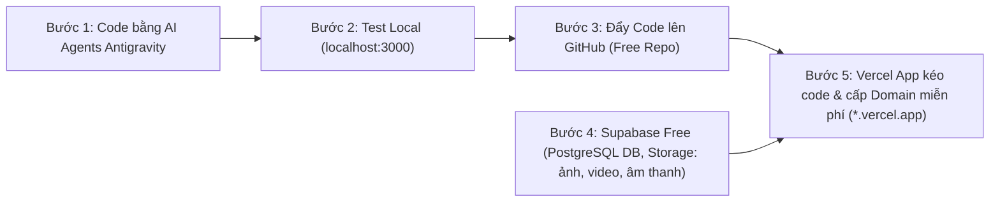
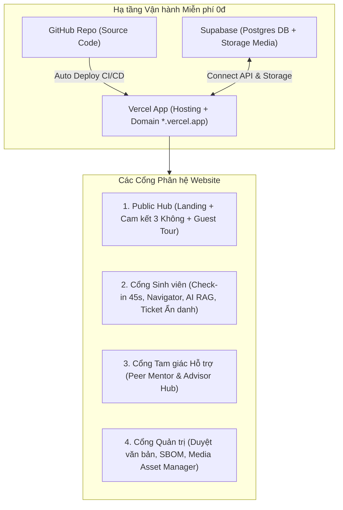
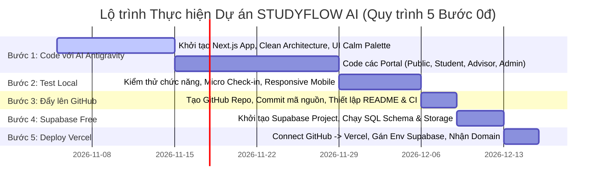

# Kế hoạch Xây dựng Website STUDYFLOW AI
**Rights-aware Student Early Support Platform**  
*Phiên bản Kế hoạch 4.0 (Tích hợp Quy trình Triển khai Vận hành 5 Bước – 100% Miễn phí / Zero-Cost Stack)*  
*Dựa trên tài liệu gốc: STUDYFLOW AI Research & Product Blueprint v1.0*

---

## 1. Tóm tắt Định hướng Chiến lược & Triết lý Phát triển

* **Định vị cốt lõi:** Nền tảng số lấy sinh viên làm trung tâm hỗ trợ nhận diện khó khăn học tập, tiếp cận đúng nguồn hỗ trợ và theo dõi quá trình hỗ trợ với nguyên tắc **Service-first, Evidence-driven, Rights-aware**.
* **Nguyên tắc then chốt:**
  * **Không phụ thuộc dữ liệu nội bộ SIS/LMS:** Giai đoạn ban đầu tập trung vào dữ liệu tự khai báo (`self_reported`) và dữ liệu tương tác thực tế (`system_recorded`). Tuyệt đối không xây dựng mô hình cảnh báo rủi ro/xếp loại thôi học khi chưa đủ dữ liệu và căn cứ đạo đức.
  * **Knowledge Provenance & IP-by-Design:** Mọi câu trả lời của AI và tài nguyên được cung cấp đều phải có trích dẫn nguồn, phiên bản, tình trạng hiệu lực và quyền sử dụng rõ ràng.
  * **Psychological Safety & Destigmatization:** Thiết kế trải nghiệm và ngôn ngữ giao tiếp xóa bỏ tâm lý e ngại tìm kiếm sự giúp đỡ của sinh viên.
  * **Chi phí 0 Đồng (Zero-Cost Operation):** Toàn bộ chu trình từ code, lưu trữ, database, storage đến hosting và tên miền đều tận dụng các gói Free Tier chính hãng trọn đời.

---

## 2. QUY TRÌNH TRIỂN KHAI VẬN HÀNH 5 BƯỚC (100% MIỄN PHÍ)

### Chi tiết 5 Bước Triển khai Miễn phí

| Bước | Hành động cụ thể | Nền tảng / Công cụ | Chi phí | Ghi chú kỹ thuật |
| :---: | :--- | :--- | :---: | :--- |
| **Bước 1** | **Lập trình Website toàn diện** | **AI Agents Antigravity** (IDE Local) | **0đ** | Code theo kiến trúc Clean Architecture, Next.js 15, Tailwind CSS, TypeScript. |
| **Bước 2** | **Kiểm thử trên máy tính cá nhân** | **Localhost** (`http://localhost:3000`) | **0đ** | Chạy kiểm thử luồng Check-in, giao diện Calm UI, responsive điện thoại, bắt lỗi trực tiếp trên máy. |
| **Bước 3** | **Đẩy mã nguồn lên kho lưu trữ** | **GitHub** (Free Public/Private Repository) | **0đ** | Quản lý phiên bản Git, lưu trữ an toàn toàn bộ source code, SBOM và lịch sử đóng góp. |
| **Bước 4** | **Thiết lập Database & Media Storage** | **Supabase Free Tier** | **0đ** | • PostgreSQL DB (500MB): Lưu user, check-in, tickets, vector embeddings. • Storage (1GB): Lưu trữ hình ảnh, video hướng dẫn, audio, văn bản PDF có dấu mộc. |
| **Bước 5** | **Deploy tự động & Cấp tên miền** | **Vercel App (Hobby Tier)** | **0đ** | • Kết nối với GitHub: Tự động kéo code mới nhất mỗi khi push code (CI/CD). • Cấp tên miền miễn phí trọn đời dạng: `https://studyflow-ai.vercel.app`. • Tự động kết nối Environment Variables với Supabase. |

---

### Bảng Chi phí Dự án (Zero-Cost Budget Table)

| Hạng mục | Dịch vụ sử dụng | Hạn mức gói Miễn phí (Free Tier) | Chi phí thực tế |
| :--- | :--- | :--- | :---: |
| **Công cụ Code** | Antigravity AI Agent | Không giới hạn tính năng cục bộ | **0 VNĐ** |
| **Lưu trữ mã nguồn** | GitHub Free | Không giới hạn Repositories, 2.000 phút CI/CD/tháng | **0 VNĐ** |
| **Cơ sở dữ liệu (Database)** | Supabase Free | 500 MB PostgreSQL, 50.000 người dùng hàng tháng (MAU) | **0 VNĐ** |
| **Lưu trữ Media (Ảnh, Video, Âm thanh)** | Supabase Storage Free | 1 GB File Storage, 2 GB băng thông tải xuống/tháng | **0 VNĐ** |
| **Máy chủ Web & Tên miền** | Vercel Hobby | Tự động SSL/HTTPS, 100 GB băng thông/tháng, Domain `*.vercel.app` | **0 VNĐ** |
| **AI LLM API** | Gemini API Free Tier | 15 RPM (Requests Per Minute), 1.500 RPD – Đủ cho giai đoạn thử nghiệm | **0 VNĐ** |
| **TỔNG CHI PHÍ** | | | **0 VNĐ (Hoàn toàn miễn phí)** |

---

## 3. Tiêu chuẩn Thiết kế Tinh chỉnh từ 3 Chuyên gia

### 3.1. Trụ cột Văn hóa Học đường & Truyền thông Thực tế
1. **Mô hình "Tam giác Hỗ trợ 3 Tầng" (Tri-Tier Support Model):**
   * **Tầng 1 (Tự động hóa):** AI Assistant + Cẩm nang Support Navigator giải quyết 80% câu hỏi quy chế, thủ tục.
   * **Tầng 2 (Đồng cấp):** Nhóm sinh viên trợ giảng, Mentor khóa trên, CLB học thuật hỗ trợ phương pháp học.
   * **Tầng 3 (Chuyên sâu):** Cố vấn học tập khoa xử lý ca học vụ phức tạp, bảo lưu, hoàn cảnh đặc biệt.
2. **Bộ từ điển Ánh xạ Văn hóa Học đường (Campus Slang-to-Policy):**
   * Tự động ánh xạ tiếng lóng sinh viên sang ngôn ngữ quy chế (*rớt môn $\rightarrow$ học phần chưa đạt, treo bằng $\rightarrow$ hoãn xét tốt nghiệp*).
3. **Bản Cam kết "3 Không" & Bộ FAQ Khủng hoảng:**
   * Không chia sẻ dữ liệu cho giảng viên chấm điểm – Không dùng kỷ luật/học bổng – Hoàn toàn tự nguyện. Sẵn sàng kịch bản dập tắt tin đồn về "giám sát sinh viên".

---

### 3.2. Trụ cột Kiến trúc Phần mềm & An ninh Dữ liệu
1. **Structure-aware Hierarchical RAG:**
   * Cắt văn bản theo thứ bậc: `[Số QĐ] + [Tên Quy chế] + [Điều X] + [Khoản Y]`. Nhúng Header vào Embeddings để triệt tiêu hoàn toàn ảo giác.
2. **Ẩn danh hóa Bảo mật với Blind Token & RLS:**
   * Sinh viên đăng nhập để lưu phiên, nhưng ticket ẩn danh được gán `blind_alias_id` mã hóa. Cố vấn không biết danh tính thật; chỉ người sở hữu token mới giải mã được phản hồi.
3. **Rate-limiting & Graceful Degradation:**
   * Redis Middleware giới hạn $\le 15$ requests/giờ/user. Vào mùa cao điểm thi cử, tự động chuyển sang chế độ **Read-only Static Navigator**.

---

### 3.3. Trụ cột UI/UX & Tâm lý học Hành vi
1. **Vòng lặp "Micro Check-in & Instant Action" (45 giây):**
   * Check-in 30s $\rightarrow$ Lập tức nhận lời khuyên hoặc tài nguyên vi mô hữu ích (Micro-Action) trong 15s.
2. **Tối ưu Bàn làm việc Cố vấn (Advisor Ergonomics):**
   * AI tóm tắt ca trong 2 dòng, cung cấp mẫu phản hồi chuẩn 1-click (Canned Responses) và đặt lịch hẹn 1-click.
3. **Bảng màu Calm Technology & Interactive Citation Drawer:**
   * Màu dịu (Slate Blue, Lavender, Warm Amber) — tránh màu đỏ cảnh báo. Trích dẫn AI dạng `Citation Pill` bấm trượt ngăn kéo xem văn bản có mộc đỏ.
4. **Onboarding Trải nghiệm Thử (Guest Tour):**
   * Cho phép dùng thử mọi tính năng ở chế độ khách trước khi tạo tài khoản.

---

## 4. Kiến trúc Tổng thể Hệ thống Website

---

## 5. Phân rã Chi tiết 4 Cổng Phân hệ

### 5.1. Cổng Sinh viên (Student Web App - Tối ưu Mobile)
* **Student Check-in:** Micro Check-in 45s (Mood/Workload), trả về ngay 1 Micro-Action hữu ích.
* **Learning Progress:** Bảng cá nhân hóa theo dõi mục tiêu, todo list do sinh viên tự quản lý.
* **Support Navigator:** Danh mục tài nguyên, video/âm thanh hướng dẫn (lưu trên Supabase Storage), cẩm nang liêm chính học thuật.
* **AI Support Assistant:** Trợ lý RAG giải đáp quy chế có `Citation Pill` mở xem văn bản gốc.
* **Support Follow-up:** Tạo ticket ẩn danh (Blind Token), nhận phản hồi Realtime, email thông báo.

### 5.2. Cổng Cố vấn & Mentor (Tri-Tier Advisor Portal - Tối ưu Desktop)
* **Phân luồng thông minh:** Tự động định tuyến ca về Peer Mentor (phương pháp học) hoặc Cố vấn khoa (học vụ phức tạp).
* **Bàn làm việc tiện ích:** Tóm tắt ca bằng AI (2 dòng), phản hồi nhanh qua mẫu soạn sẵn 1-click, đề xuất lịch hẹn 1-click.

### 5.3. Cổng Quản trị Tri thức & Dữ liệu (Admin Hub)
* **Knowledge Provenance:** Duyệt văn bản quy chế, bóc tách theo Chương-Điều-Khoản.
* **Media & Asset Manager:** Quản lý file ảnh, video bài giảng, audio thiền/tập trung tải lên Supabase Storage.
* **SBOM & Bản quyền:** Danh mục giấy phép mã nguồn mở (MIT, Apache) và bản quyền tài nguyên UI.

### 5.4. Cổng Công khai & Minh bạch (Public Hub)
* **Landing Page:** Giới thiệu sứ mệnh, **Cam kết 3 Không**, Onboarding trải nghiệm thử (Guest Tour).
* **Khảo sát Nhu cầu Sinh viên:** Biểu mẫu thu thập dữ liệu nghiên cứu có Consent Form.
* **Trang Quyền riêng tư & Credits:** Minh bạch theo Luật Dữ liệu và vinh danh đóng góp.

---

## 6. Mô hình Cơ sở Dữ liệu & Storage (Supabase Free Tier)

### 6.1. Bảng Dữ liệu (PostgreSQL)
* `users`: `id`, `email`, `role` (`student`, `peer_mentor`, `advisor`, `admin`), `display_name`, `created_at`.
* `consents`: `id`, `user_id`, `purpose`, `is_agreed`, `agreed_at`.
* `checkins`: `id`, `user_id`, `energy_level` (1-5), `difficulty_tags` (array), `micro_action_id`, `source_tag` (`self_reported`), `created_at`.
* `micro_actions`: `id`, `title`, `description`, `action_url`, `media_url`, `is_active`.
* `knowledge_docs`: `id`, `doc_code`, `doc_title`, `issuing_org`, `effective_date`, `file_url`, `status` (`approved`, `pending`), `reviewed_by`.
* `doc_chunks`: `id`, `doc_id`, `chapter`, `article`, `clause`, `content`, `full_header_path`, `embedding` (vector 1536).
* `support_tickets`: `id`, `student_id`, `blind_alias_id`, `tier` (`peer`, `advisor`), `category`, `title`, `description`, `status`, `assigned_to`, `created_at`.
* `ticket_messages`: `id`, `ticket_id`, `sender_id`, `message`, `attachment_url`, `created_at`.

### 6.2. Buckets Lưu trữ Media (Supabase Storage - Hạn mức 1GB Free)
* `doc-pdfs/`: Chứa các file PDF văn bản quy chế, quyết định học vụ chính thức có mộc đỏ.
* `media-assets/`: Chứa hình ảnh minh họa, icon UI, infographic cẩm nang học đường.
* `video-guides/`: Chứa các video/audio ngắn (mp4/mp3) hướng dẫn phương pháp học tập, giảm căng thẳng.

---

## 7. Lộ trình Thực thi Chi tiết Theo 5 Bước Miễn phí

| Giai đoạn | Mục tiêu thực hiện | Đầu ra kiểm chứng | Chi phí |
| :---: | :--- | :--- | :---: |
| **Bước 1** | Code hoàn chỉnh website bằng Antigravity | Toàn bộ source code chuẩn Clean Architecture trên máy. | 0đ |
| **Bước 2** | Chạy và test mượt mà trên `localhost:3000` | Xác nhận hoạt động mọi tính năng, không lỗi giao diện. | 0đ |
| **Bước 3** | Khởi tạo repo GitHub và push toàn bộ code lên | Repo GitHub an toàn, sẵn sàng CI/CD tự động. | 0đ |
| **Bước 4** | Cấu hình Supabase: Bảng dữ liệu + Buckets Media | Database PostgreSQL và kho chứa ảnh/video hoạt động. | 0đ |
| **Bước 5** | Kết nối Vercel với GitHub, cấp domain `*.vercel.app` | Website chính thức online toàn cầu, tự động cập nhật. | 0đ |
